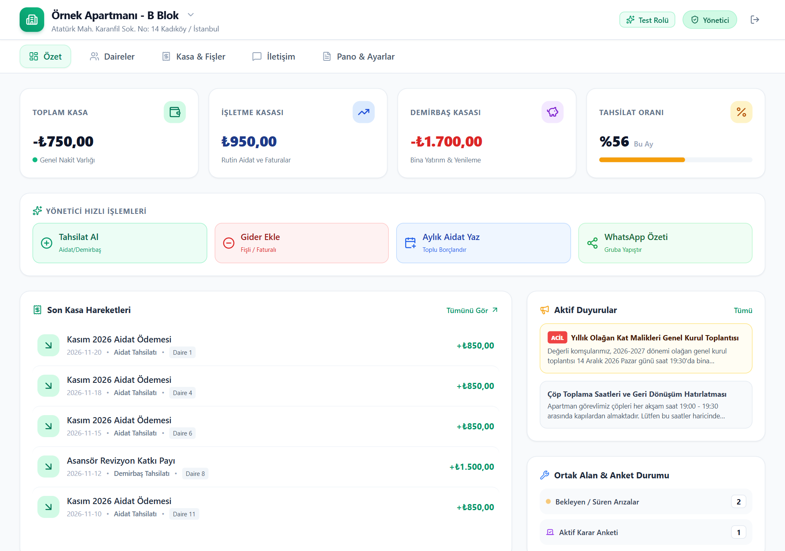
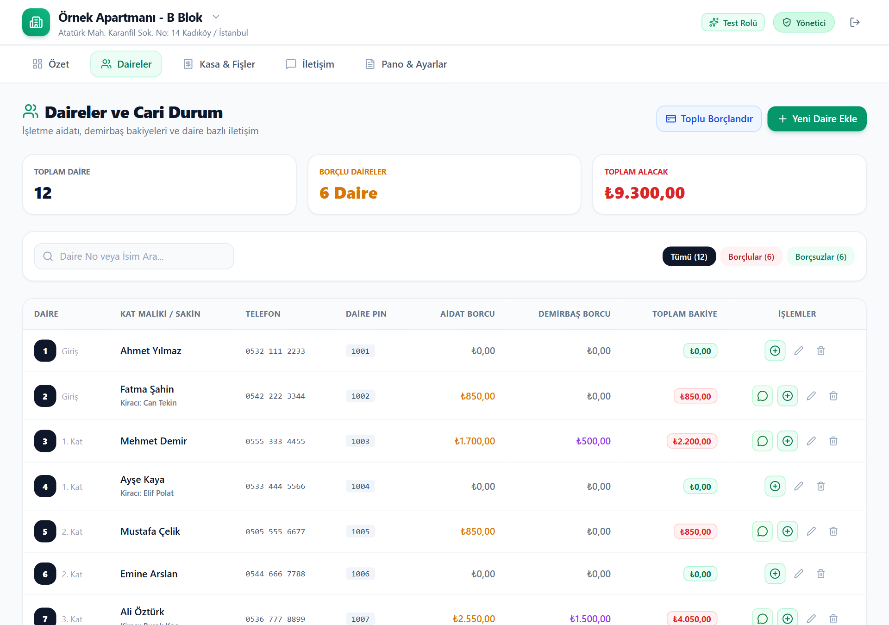
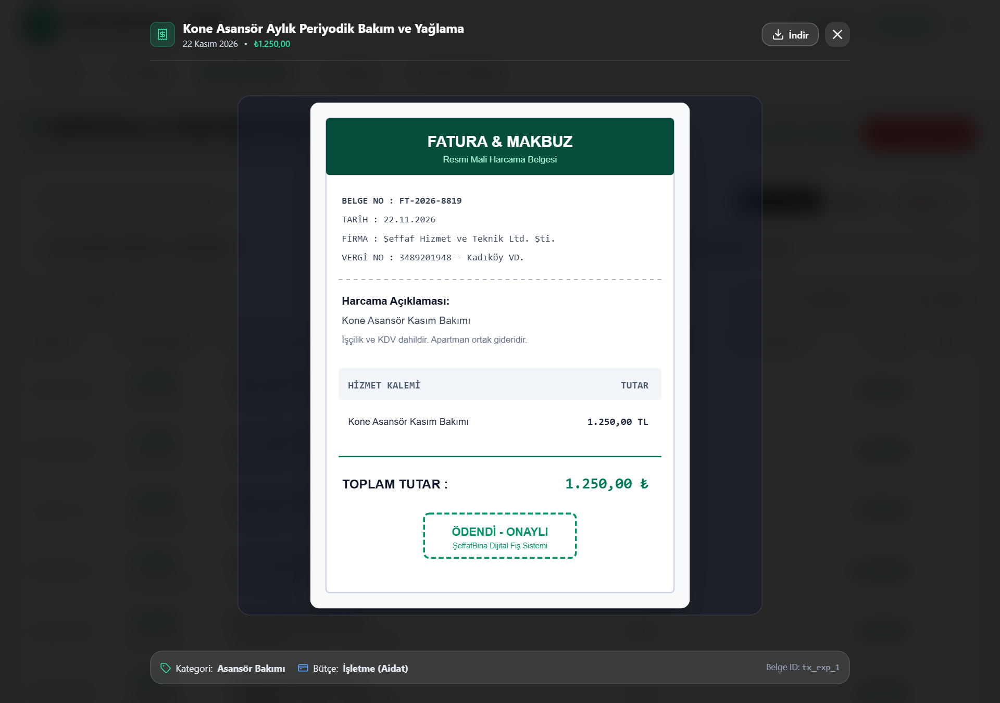
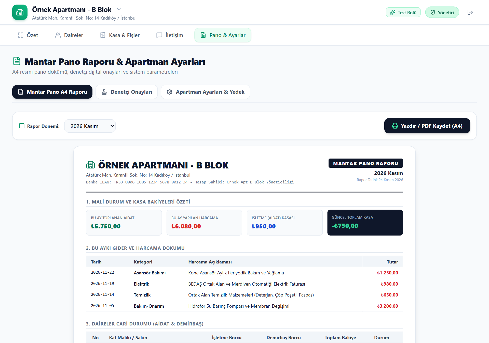

# 🏢 ŞeffafBina — Apartman ve Site Yönetim Web Uygulaması (PWA)

[](https://opensource.org/licenses/MIT)
[](https://react.dev/)
[](https://vitejs.dev/)
[](https://tailwindcss.com/)
[](https://developer.mozilla.org/en-US/docs/Web/Progressive_web_apps)

Türkiye'deki **10-50 daireli apartmanlarda** bireysel yöneticilik yapanlar, denetçiler ve kat malikleri için geliştirilmiş; **mobil öncelikli**, **çoklu apartman (multi-tenant) destekli**, **çift kasalı (İşletme Aidatı & Demirbaş)** ve **fiş fotoğraflı** yeni nesil dijital yönetim sistemi.

---

## 📸 Ekran Görüntüleri

| 1. Yönetici Kontrol Paneli | 2. Daireler & Cari Matris |
| :---: | :---: |
|  |  |

| 3. Tam Ekran Fiş / Fatura Lightbox | 4. A4 Mantar Pano Resmi Raporu |
| :---: | :---: |
|  |  |

---

## 🌟 Öne Çıkan Özellikler

- **Çift Kasa Mimarisi:** Rutin giderler için *İşletme (Aidat) Kasası* ile bina yatırımları için *Demirbaş Kasası* birbirinden kesin olarak ayrılır.
- **HTML5 Canvas Fiş Sıkıştırma:** Yüklenen faturalar otomatik olarak max **900px** ve **0.7 JPEG** kalitesine sıkıştırılarak saklanır. Tam ekran **Lightbox** ile incelenebilir ve indirilebilir.
- **Tek Tık WhatsApp Hatırlatıcı:** Borçlu daire sakinlerine tek tıkla IBAN ve borç tutarını içeren resmi hatırlatma mesajı açar.
- **Aylık WhatsApp Grup Özeti:** Kasa bakiyelerini ve son harcamaları tek tıkla panoya kopyalayıp apartman grubunda paylaşma imkanı.
- **Mantar Pano A4 Çıktısı (KMK Uyumlu):** Kat Mülkiyeti Kanunu uyarınca panoya asılmaya hazır tek sayfalık resmi A4 dökümü (`@media print` ile optimize).
- **Denetçi Dijital Damgası:** Denetçiler dönemleri inceleyip resmi `DNT-XXXXXX` dijital onay kodu basabilir.
- **Karar Anketleri:** Daire başına kesinlikle **1 oy** kullanılır; sonuçlar canlı çubuk grafikle gösterilir.
- **Ortak Alan Arıza Takibi:** Sakinler fotoğraflı arıza açar; yönetici `Beklemede` → `İşleme Alındı` → `Çözüldü` olarak takip eder.
- **Çoklu Apartman (Multi-Tenant):** URL parametresi (`?bina=...`) veya arayüzden binalar arası anında geçiş.
- **JSON Tam Yedekleme & Geri Yükleme:** Tüm binayı tek tıkla indirip başka cihaza aktarma garantisi.

---

## 🔑 Demo Giriş PIN Kodları

Uygulamada test kolaylığı için giriş ekranında tek tıkla erişilebilen **Kolay Demo Çubuğu** bulunmaktadır:

| Rol | Giriş Yolu | Varsayılan PIN | Yetki Kapsamı |
| :--- | :--- | :--- | :--- |
| 👔 **Yönetici** | Yönetici Sekmesi | `1923` | Tam yetki: Tahsilat, gider, toplu borçlandırma, WhatsApp, duyuru, ayarlar. |
| 📋 **Denetçi** | Denetçi Sekmesi | `2025` | Salt-okunur inceleme + dönemlere "Denetlendi ve Onaylandı" mühür damgası. |
| 🏠 **Daire Sakini** | Daire Seçimi + PIN | `1001` (Daire 1) | Kendi dairesinin borç/ödeme geçmişi, kasa özeti, arıza açma, ankette oy kullanma. |
| 🛡️ **Süper Admin** | Admin Sekmesi | `9999` | Portföye yeni bina ekleme, bina silme, aidat/IBAN belirleme. |

---

## 🚀 Hızlı Başlangıç

### Gereksinimler
- Node.js (v18 veya üzeri)
- npm veya yarn

### Kurulum ve Çalıştırma

```bash
# Bağımlılıkları yükleyin
npm install

# Geliştirme sunucusunu başlatın
npm run dev

# Üretim (Production) derlemesi alın
npm run build

# Üretim çıktısını test edin
npm run preview
```

---

## 📄 Kullanım Kılavuzu & Dokümantasyon

Tüm ekranların adım adım açıklamalarını içeren 14 sayfalık resmi el kitabı:
- [Kullanım Kılavuzu (PDF)](docs/SeffafBina_Kullanim_Kilavuzu.pdf)
- [Kullanım Kılavuzu (HTML)](docs/Kullanim_Kilavuzu.html)

---

## 📜 Lisans

Bu proje [MIT Lisansı](LICENSE) kapsamında açık kaynak olarak yayınlanmıştır.
